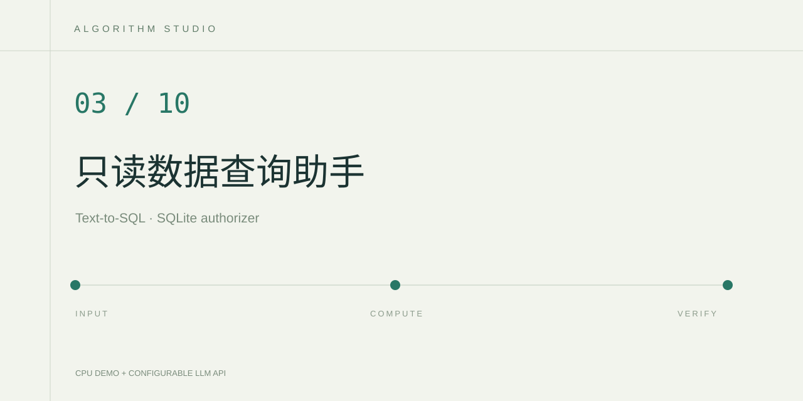

# Read-only SQL Copilot

通过自然语言查询一份合成工厂数据库，展示实际生成和执行的 SQL、查询结果，以及只读控制过程。演示设备、传感器读数与工单全部来自 `data/factory.json`。

## 实现内容

- 本地模式用显式意图规则生成温度、振动、工单、车间统计查询。
- API 模式先生成 SQL，执行完成后再调用一次模型解释实际结果。
- 每次请求创建固定的内存数据库，用户输入无法选择本地数据库文件。
- 使用 SQLite `query_only` 与 `set_authorizer` 双重控制，限制表、函数与操作类型。
- 通过单语句执行、指令预算、时间限制和返回行数上限限制查询开销。

SQL 输入会经过同一条检查和执行链。可以直接输入 `SELECT COUNT(*) FROM measurements`，也可试验 `DELETE FROM equipment` 等被拒绝的操作。模型产生的 SQL 可能错误，页面会返回错误并保留数据保护。

## 在 PyCharm 运行

用 Python 3.12 打开当前目录，安装 `requirements.txt`，运行 `app.py`。本地模式无需 API。API 模式按 `.env.example` 在本机运行配置中设置密钥与模型，单次演示通常调用模型两次。

## 评估与边界

运行 `python -m unittest discover -s tests`，验证聚合数值、连接查询、WITH 查询及写入、多语句、扩展、系统表、递归查询的拒绝。

建议建立自然语言问题与参考 SQL 或参考结果对照表，报告执行结果正确率和拒绝测试的实际通过情况。当前保护围绕固定的合成 SQLite 演示库设计。接入真实业务数据库时，应进一步使用数据库层只读账户、表级授权和独立执行服务。单凭 SQL 关键字检查无法提供等效隔离。

## 参考

- [Python sqlite3 官方文档](https://docs.python.org/3/library/sqlite3.html)
- [SQLite authorizer](https://www.sqlite.org/c3ref/set_authorizer.html)
- [SQLite query_only](https://www.sqlite.org/pragma.html#pragma_query_only)
